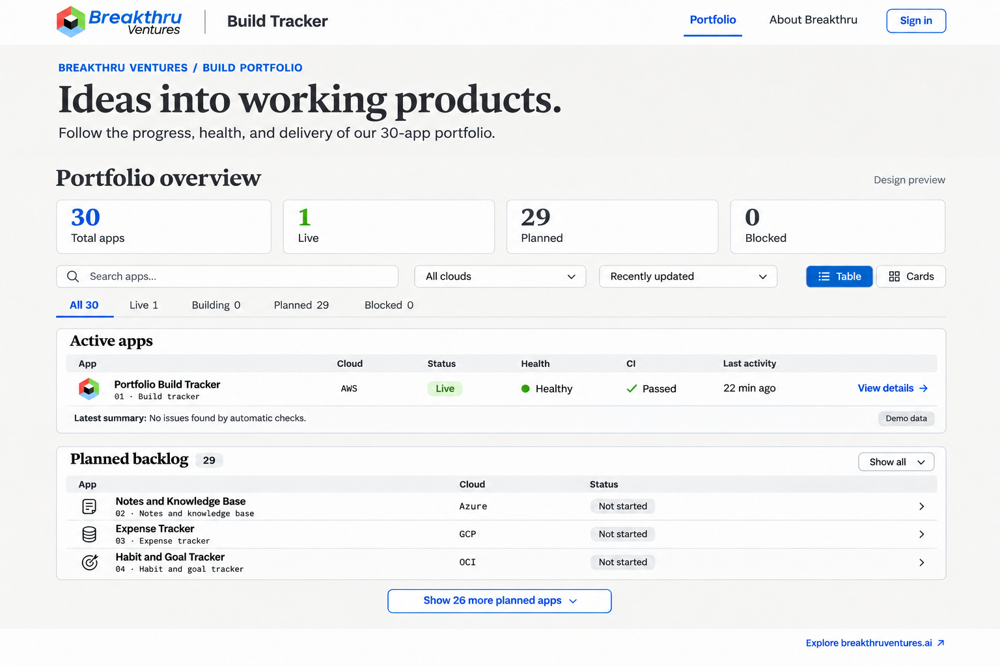

# Portfolio board design reference

This image records the design direction approved in the design review. It is a
visual reference, not a replacement for a working responsive interface. The
counts and activity timestamps shown are illustrative; render current data in
the application.

## Branding

- Keep the full Breakthru Ventures logo in the upper-left navigation header.
- Do not add the large cube in the upper-right introduction or a logo in the footer.
- Retain the footer link to breakthruventures.ai.
- Use original logo assets rather than extracting artwork from this generated
  mockup. The supplied originals are named `BreakthruLogo819.png` and
  `bvcolorlogo.jpeg`; store production copies under `public/branding/`.
- Match the homepage font system: Newsreader for display headings, Public Sans
  for interface text, and IBM Plex Mono for technical identifiers. These font
  families were verified from breakthruventures.ai's homepage styles.

## Implementation map

| Area | Existing source | Intended change |
| --- | --- | --- |
| Header and footer | `src/app/layout.tsx` | Brand header and footer link |
| Typography and colors | `src/app/globals.css` | Font families and shared design tokens |
| Portfolio board | `src/app/(board)/page.tsx` | Introduction, totals, search, cloud filters, sorting, and table/card views |
| App entries | `src/components/app-card.tsx` | Compact entries, clear detail links, and mobile presentation |
| Status UI | `src/components/tracker-ui.tsx` | Meaningful health labels and neutral unstarted states |

Keep live app health and build information visible. Present planned apps as a
compact backlog without repeating unavailable health, CI, and push data. Expand
the backlog on demand. Label demo summaries as “Demo data”; this is a data badge,
not an app-opening action. Preserve existing links and server authorization.

Support 375px-wide screens with stacked summary panels, usable touch targets,
and compact expandable entries. The desktop mockup does not prescribe a fixed
canvas size or horizontal page overflow.

## Reuse across the portfolio

Implement and validate the design in this app first. Then move reusable branding,
tokens, layout, and components into `30-apps-template` or a shared package in a
separate change. Each app retains its own name, features, navigation, and data.
Adding this reference does not update the deployed app or the other repositories.
